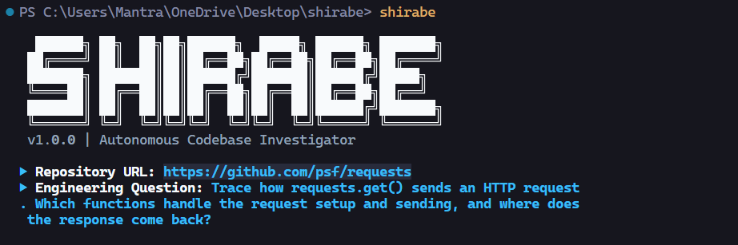
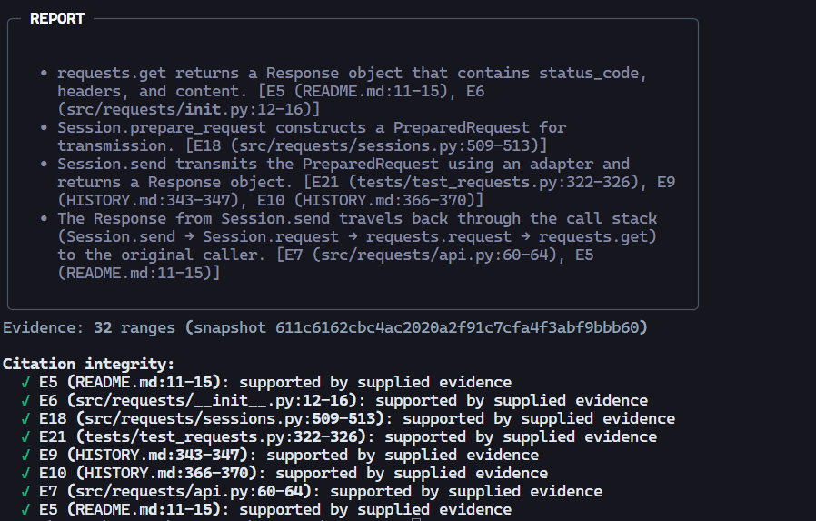

# Shirabe

**Evidence backed answers to questions about public GitHub codebases.**

Shirabe is a Python CLI that investigates a repository and answers engineering questions with source excerpts and checked file and line citations. It uses a bounded LangGraph workflow to plan searches, collect evidence, analyze results, and answer—or abstain when the checkout does not provide enough evidence.

## Screenshots





## Install

Requirements: Python 3.11+, Git, and an OpenRouter API key for live investigations.

```powershell
python -m venv .venv
.venv\Scripts\Activate.ps1
pip install -r requirements.txt
pip install -e .
Copy-Item .env.example .env
```

On macOS/Linux, replace activation with `source .venv/bin/activate` and copy `.env.example` with `cp .env.example .env`.

Add these settings to `.env`:

```env
OPENROUTER_API_KEY=your_openrouter_api_key
OPENROUTER_MODEL=nvidia/nemotron-3.5-lightning:free
```

Keep API keys private. `.env` is gitignored.

## Use

```bash
shirabe "https://github.com/psf/requests" "Trace how requests.get() sends an HTTP request. Which functions handle request setup and sending, and where does the response come back?"
```

Run `shirabe` without arguments for interactive prompts. Shirabe supports public GitHub repositories, shallow-clones each repository to a temporary directory, then cleans up the clone after the investigation.

## Demo and reports

Run the local demo without credentials or network access:

```bash
python demo.py
python demo.py --save-report demo-report.json
```

Save or inspect a live investigation report:

```bash
shirabe <repo-url> <question> --save-report report.json
shirabe --inspect-report report.json
shirabe --attach-review report.json --labels 1,0,1
shirabe --delete-report report.json
```

Reports are versioned JSON, saved only on request. They contain bounded evidence excerpts and run metadata, not secrets, full repository contents, prompts, or tracing data. Review labels are optional.

## How it works

The planner proposes 3–5 keyword searches. The investigator searches supported text files and gathers bounded source ranges. The analyzer can request up to three search passes by default. The explainer returns claims with citations, and Shirabe checks each cited ID, path, and line range against the evidence provided to the model.

Search is lexical rather than semantic or syntax-aware, so it can miss code connected through imports, symbol definitions, or dynamic behavior. Citation checks verify references, not whether cited lines logically prove a claim. Shirabe reads source only: it does not execute repository code or modify the target checkout.

LangSmith tracing is off by default. If enabled, traces may contain the question, queries, and repository excerpts sent to the model.

## Evaluation

Run the deterministic, credential-free fixture benchmark:

```bash
python evaluate.py --mode fixture
```

The six versioned cases cover single-file behavior, cross-file flows, configuration, a failure path, and an unanswerable question. Latest recorded results:

| Metric | Result |
|---|---:|
| File recall@5 | 8/9 |
| Range recall | 9/11 |
| Citation integrity | 18/18 |
| Abstention precision / recall | 1/1, 1/1 |
| Claim support | Unlabeled; requires human review |

The known misses involve a same-file symbol definition and a cross-file import. These small fixture results are regression signals, not general accuracy claims. See [fixture notes](tests/fixtures/README.md). Live benchmark mode uses the configured OpenRouter model and requires an API key; fixture mode remains the reproducible, credential-free evaluation path.

## Configuration

| Variable | Default | Purpose |
|---|---:|---|
| `OPENROUTER_API_KEY` | — | Required for live model calls |
| `OPENROUTER_MODEL` | `nvidia/nemotron-3.5-lightning:free` | Model name |
| `LANGSMITH_TRACING` | `false` | Enable tracing |
| `LANGSMITH_API_KEY` | — | Required when tracing is enabled |
| `LANGSMITH_PROJECT` | `shirabe` | Tracing project |
| `SHIRABE_MAX_ITERATIONS` | `3` | Maximum investigation passes |
| `SHIRABE_CLONE_TIMEOUT_SECONDS` | `120` | Clone timeout in seconds |
| `SHIRABE_MAX_REPO_FILES` | `4000` | Maximum repository files |
| `SHIRABE_MAX_REPO_TOTAL_BYTES` | `200000000` | Maximum repository size |
| `SHIRABE_MAX_FILE_BYTES` | `500000` | Maximum searchable file size |
| `SHIRABE_MAX_EVIDENCE_CHARS` | `30000` | Maximum evidence sent for analysis |

## Development

Install development dependencies and run checks:

```bash
pip install -r requirements-dev.txt
pytest
ruff check .
mypy config.py errors.py tools.py nodes.py main.py graph.py state.py evaluate.py evidence.py eval_cases.py eval_metrics.py report.py demo.py
pip-audit -r requirements.txt
```

CI also runs the fixture benchmark, demo, and whitespace check on pushes and pull requests.

## Project structure

`main.py` and `graph.py` implement the CLI and workflow; `nodes.py`, `tools.py`, and `evidence.py` handle investigation and citation checks. `config.py` and `errors.py` manage settings and failures. `report.py` handles exports; `evaluate.py`, `eval_cases.py`, and `eval_metrics.py` provide fixture evaluation. `tests/` contains regression tests, and `docs/plan.md` describes the roadmap.

The fixture examples are original and MIT licensed; see [fixture provenance](tests/fixtures/README.md). There is currently no top-level `LICENSE` file.
